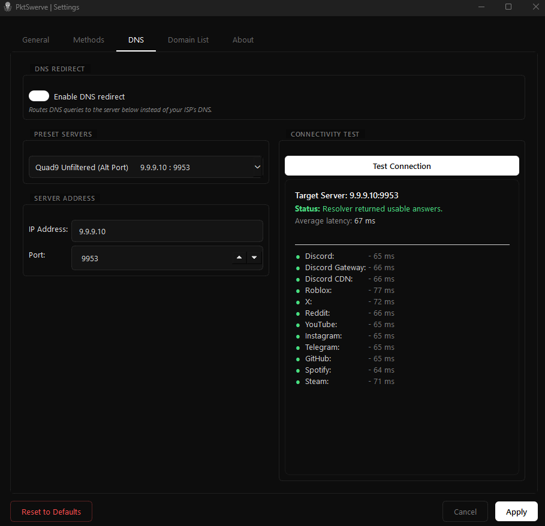
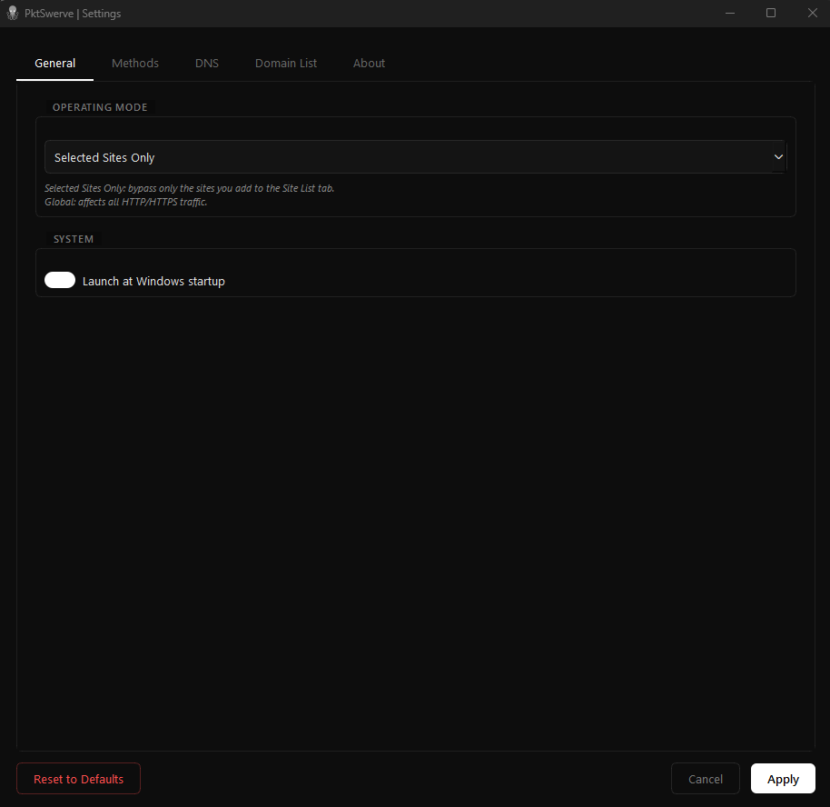
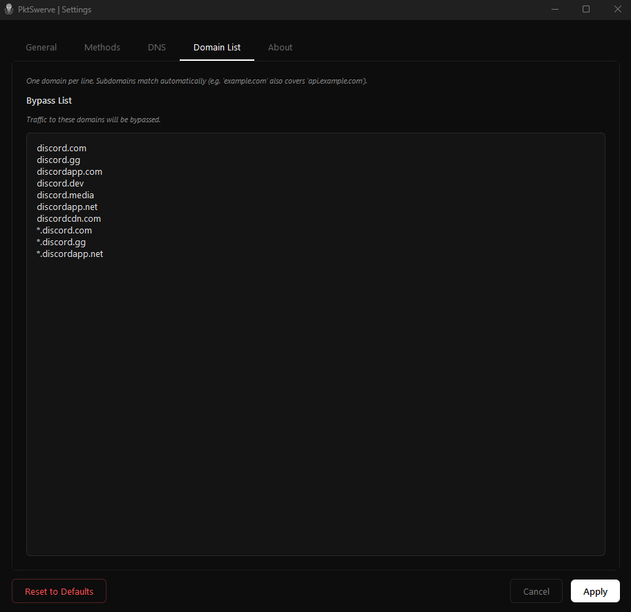

# PktSwerve

PktSwerve is a Windows desktop tray application that applies packet-level techniques to selected network traffic. It uses [WinDivert](https://reqrypt.org/windivert.html) to inspect and modify packets locally; it is not a VPN, proxy, encryption tool, or anonymity service.





## Current status

- **Windows 10/11 (64-bit):** WinDivert backend, packet-level techniques.
- **macOS 12+ (Apple Silicon and Intel):** menu bar app. A pf redirect rule sends HTTP, HTTPS and DNS traffic to a local proxy that splits the first packet (and optionally the TLS record) before forwarding it. Reordering and fake packets are not available there. Requires administrator permission, asked on first start.
- Linux and Android are not supported.

## Features

- System-tray interface with start/stop controls.
- Global mode or a domain list for selective processing.
- TLS ClientHello fragmentation for HTTPS traffic.
- HTTP request fragmentation for plaintext HTTP on port 80.
- Optional low-TTL, invalid-checksum, and incorrect-sequence-number decoy packets.
- Optional DNS redirection to a configurable server and port.
- Built-in DNS connectivity checks.
- Optional Windows logon task for automatic startup and connection.
- Local packet processing; traffic is not routed through a PktSwerve server.

## Requirements

### Running a release

- 64-bit Windows 10 or Windows 11.
- Administrator privileges. WinDivert requires access to the Windows network layer; the application requests elevation when it starts.
- `PktSwerve.exe`, `WinDivert.dll`, and `WinDivert64.sys` in the same release directory.

WinDivert loads its driver at runtime. Do not rename or remove the WinDivert files from a release package.

### Building from source

- CMake 3.16 or newer.
- Qt 5 or Qt 6 with the Widgets, Network, and Concurrent components.
- A C++17-compatible compiler.
- WinDivert development files at these paths:

  ```text
  vendor/windivert/include/windivert.h
  vendor/windivert/lib/WinDivert.lib
  ```

The `vendor/windivert` directory is ignored by Git because it contains third-party binaries. Obtain WinDivert from its official distribution and place the required files at the paths above before configuring the project.

## Installation

For a release build, extract the complete package to a directory and run `PktSwerve.exe`. Accept the Windows elevation prompt when asked. The application starts in the notification area; click the tray icon to open the controls.

If the package does not contain the WinDivert runtime files, copy `WinDivert.dll` and `WinDivert64.sys` beside `PktSwerve.exe` before launching it.

### macOS

Paste this single line into Terminal. It downloads the latest build and installs it without any Gatekeeper warning (no Apple Developer account is involved: files fetched with `curl` are not quarantined):

```bash
curl -fsSL https://raw.githubusercontent.com/luridlane-dev/PktSwerve/main/packaging/macos/install.sh | bash
```

Then click the menu bar icon and press **Start**. macOS asks for your password once per session; the app itself keeps running as your normal user, and a small root helper process sets up the network rules. If something goes wrong, the logs `pktswerve.log` and `pktswerve-helper.log` are in `~/Library/Application Support/PktSwerve/`. To remove the app, append `-s -- --uninstall` to `bash` in the command above.

Prefer the disk image? Download `PktSwerve-macOS.dmg` from the [macos-latest release](https://github.com/luridlane-dev/PktSwerve/releases/tag/macos-latest), then right-click `Install PktSwerve.command` and choose Open. If macOS still blocks it, use System Settings → Privacy & Security → **Open Anyway**. The app is not notarized, so a browser-downloaded copy needs one of these steps.

On macOS, if the configured DNS redirect server stops answering, the proxy sends queries to the resolver the system originally chose, so name resolution keeps working.

## Building

From a PowerShell or command prompt in the repository root:

```powershell
cmake -S . -B build -G Ninja -DCMAKE_BUILD_TYPE=Release
cmake --build build --parallel
```

With a Visual Studio generator, configure without `-G Ninja` and build the Release configuration explicitly:

```powershell
cmake -S . -B build
cmake --build build --config Release
```

The executable is written to `build/PktSwerve.exe` for a Ninja build or to the generator-specific Release output directory. Copy the WinDivert runtime files beside the executable before running it.

## Using the application

### Start and stop

1. Launch PktSwerve and approve elevation if Windows asks for it.
2. Open the tray popup and choose **Start**.
3. Choose **Stop** to stop packet processing.
4. Open **Settings** to change the configuration.

Applying settings while the engine is running restarts the backend so the changes take effect.

### Operating modes

- **Disabled**: leaves traffic unchanged.
- **Selected Sites Only**: processes only domains entered in the **Domain List** tab. Enter one domain per line. A domain also matches its subdomains; for example, `example.com` matches `api.example.com`.
- **Global**: processes all supported HTTP/HTTPS traffic. In this mode, UDP/443 (QUIC) is dropped so compatible clients can fall back to TCP.

The current user interface exposes the first, second, and third modes. The source also contains an internal whitelist enum, but there is no whitelist control in the current UI.

### Methods

The **Methods** tab controls the packet techniques:

- **HTTPS / TLS ClientHello fragmentation** splits the TLS handshake across packets. The application buffers segmented ClientHello messages when needed and uses the hostname in SNI for domain matching.
- **HTTP fragmentation** handles plaintext HTTP requests sent to port 80.
- **Send fragments in reverse order** changes the order of the generated fragments. Some networks may behave differently with this option enabled.
- **Low-TTL fake packet**, **wrong TCP checksum**, and **wrong sequence number** send optional decoy packets. These techniques can disrupt connections on some networks; enable them one at a time when troubleshooting.
- Fragment sizes are configurable from 1 to 512 bytes. The default is 2 bytes.

### DNS

The **DNS** tab can redirect DNS queries to a selected preset or to a manually entered IP address and port. The redirect follows the selected operating mode: in **Selected Sites Only** mode, only matching domains are redirected; in **Global** mode, all observed UDP DNS queries are eligible.

Use **Test Connection** to send direct UDP DNS queries to the configured server. The test reports the result and latency for several known domains. It does not change the system DNS settings.

### Automatic startup

The **Launch at Windows startup** option creates or removes a Windows Task Scheduler task named `PktSwerve`. When enabled, the task runs at logon with the highest requested privileges and starts the application’s automatic connection sequence.

## Configuration and logs

Settings are saved as JSON in Qt’s Windows application configuration directory. On a typical Windows installation this is under:

```text
%LOCALAPPDATA%\PktSwerve\config.json
```

The exact path is written to the application log. The log is stored in the same local application-data area as `pktswerve.log`; a previous log is rotated to `pktswerve.log.1` when the application starts.

Use **Reset to Defaults** in the Settings window instead of editing the JSON file while the application is running. Manual edits must contain valid JSON and valid DNS address/port values.

## How packet processing works

PktSwerve opens a WinDivert network-layer handle and forwards packets after applying the selected method. For TCP traffic, it recognizes TLS ClientHello messages and basic HTTP methods, extracts SNI or `Host`, and checks that hostname against the configured mode. DNS redirection records the original destination and rewrites matching replies back to the requesting client.

PktSwerve does not decrypt TLS traffic. It can only match hostnames that are visible in the packet data, and it does not provide protection against traffic analysis, endpoint tracking, or application-level logging.

## Troubleshooting

### The application exits or cannot start WinDivert

- Run the application as administrator and accept the elevation prompt.
- Verify that `WinDivert.dll` and `WinDivert64.sys` are beside `PktSwerve.exe`.
- Check that the WinDivert files match the architecture of the executable.
- Check the log for the WinDivert error code.
- Temporarily check whether another packet-filtering product or security policy is blocking WinDivert.

### DNS test fails

- Verify the server address and port in the DNS tab.
- Check that the network allows outbound UDP traffic to that port.
- Test the server while PktSwerve is stopped if another filter is active.

### A site does not work after enabling a method

- Confirm that the domain is present in **Selected Sites Only** mode.
- Try the default fragment size of 2 bytes.
- Disable reverse ordering and the decoy-packet options first.
- Remember that some applications use QUIC or encrypted DNS paths that are outside the TCP/UDP handling described above.

### No tray icon appears

The application requires a Windows notification area. If the process starts without a tray, check Windows notification-area settings and the log for the `System tray is not available` message.

## Development notes

There are currently no automated CTest tests in the project. A successful configure and build verifies compilation and linking, but it does not verify behavior on a specific ISP or network. Packet-processing changes should be tested on an isolated network and with a way to stop the backend quickly.

## Privacy and security

Packet inspection and modification happen locally. PktSwerve does not provide a remote relay, encrypt traffic, or make the user anonymous. Running with administrator privileges gives the process access to low-level network operations, so use release binaries and WinDivert files from sources you trust.

## License

PktSwerve is licensed under the GNU General Public License v3.0. See [LICENSE](LICENSE) for the full text.

## Disclaimer

Use PktSwerve only on networks and traffic you are authorized to modify. DPI bypass may be restricted by local law, network policy, or a service agreement. You are responsible for complying with all applicable rules and for any consequences of using the software.

## Links

- [GitHub repository](https://github.com/luridlane-dev/PktSwerve)
- [Issue tracker](https://github.com/luridlane-dev/PktSwerve/issues)
- [Project website](https://luridlane.com)
